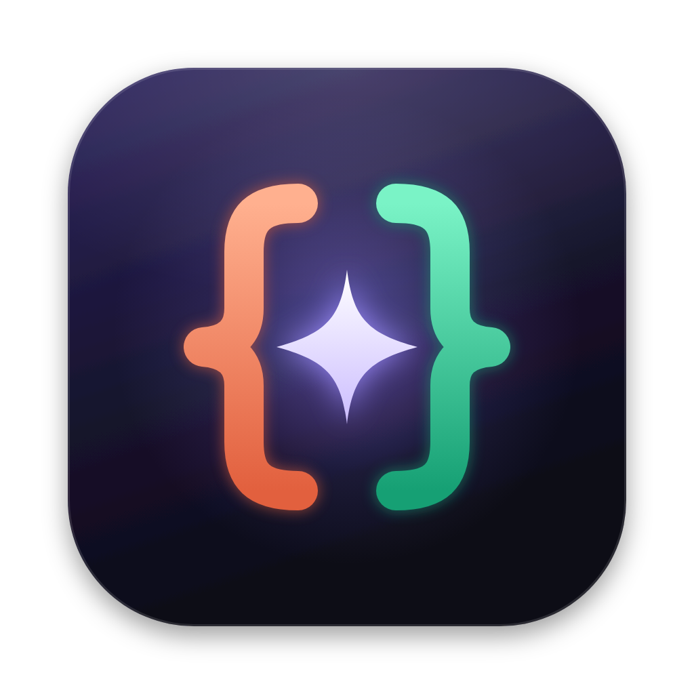

# Ambidex

> *Claude Code y Codex, trabajando como uno.* · [English](README.md)



Aplicación de escritorio para macOS para desarrollar con **Claude Code** y **OpenAI Codex**: chatea con cada uno por separado, con los dos a la vez en un chat que se organiza solo, o encarga tareas grandes al **equipo**. En el equipo se reparten el trabajo, cada uno trabaja en su rama, se revisan entre ellos y tú apruebas el resultado.

Ejecuta los **CLI oficiales** instalados en tu Mac con las cuentas en las que ya has iniciado sesión (claude.ai / ChatGPT). No usa APIs, no pide claves y no guarda credenciales.

Arquitectura, modelo de datos y decisiones: [docs/ARCHITECTURE.md](docs/ARCHITECTURE.md).

## Instalar

```bash
npm install            # dependencias y node-pty compilado para Electron
npm run dist           # compila y empaqueta "Ambidex.app" (firma ad hoc)
npm run install:app    # la copia a /Applications, crea un acceso en el Escritorio y la abre
```

Requisitos:
- macOS en Apple Silicon (probado en macOS 27)
- Node 22.15 o superior (recomendado 24)
- Git
- [Claude Code](https://code.claude.com) con sesión iniciada (`claude auth login`)
- [Codex CLI](https://github.com/openai/codex) con sesión iniciada (`codex login`)

No hace falta Xcode. Si falta alguna sesión, **Ajustes → Agentes y cuentas** abre el login oficial de cada CLI en una terminal real dentro de la app.

Para desarrollar: `npm run dev` (recarga en caliente) o `npm run build && npm start`.

## Cómo se usa

Cada proyecto es una **pestaña** arriba, como en un navegador. Para abrir uno: ⌘O, arrastra una carpeta a la ventana o suéltala en el icono del Dock. En cada pestaña eliges cómo trabajar:

| Modo | Qué hace |
|---|---|
| **Claude** | Chat con Claude Code. |
| **Codex** | Chat con Codex. |
| **Ambos · Un chat** | Un único chat con los dos. Un **motor de enrutado** decide en cada mensaje quién responde según el tipo de tarea, si un agente está ocupado, su uso del plan y si el mensaje sigue la conversación anterior. Cada respuesta indica a quién fue y por qué. El agente que entra recibe el **contexto** de lo hablado con el otro. Con `@claude` o `@codex` eliges tú. |
| **Ambos · Lado a lado** | Dos chats independientes en paralelo, con la opción de enviar la misma tarea a los dos (cada uno en su worktree, si quieres). |
| **Equipo** (destino del chat Ambos) | Para tareas grandes. Ver más abajo. |
| **Web** (botón de la misma barra) | Un navegador junto al chat. Ver más abajo. |

Siempre a mano: **modelo**, **razonamiento** y **permisos** del agente que va a responder.

**Cola:** si el agente está ocupado, lo que escribas se encola. Puedes editarlo, quitarlo o enviarlo ya; sale solo cuando el agente queda libre y sobrevive a reinicios.

En el cuadro de texto:

- **Imágenes:** pégalas (⌘V), arrástralas o usa el botón de imagen. Los dos agentes las ven: Claude las recibe en el mensaje y Codex con `--image`.
- **Prompts con `/`:** escribe `/` al principio y elige uno (`/revisa`, `/arregla`, `/tests`, `/explica`, `/plan` y los tuyos). Se gestionan en **Ajustes → Prompts**.
- **Deshacer un turno:** al final de cada turno que cambió ficheros aparece **Deshacer los cambios de este turno**.
  - Te enseña qué ficheros se restaurarían o borrarían y pide confirmación.
  - Los ficheros que hayas tocado después no se tocan.
  - Funciona en proyectos con Git. Las fotos de antes y después son *trees* de Git escritos con un índice temporal: no tocan tu índice, tus ramas ni tu historial.

### Visor web

- **Abrir:** pulsa **Web** en la barra de arriba. Los enlaces que escriben los agentes (también `localhost:5173` sin `http://`) y los de la terminal se abren ahí; con ⌘-clic, en tu navegador. Clic derecho en un enlace del chat: abrir en Web, abrir en el navegador o copiar.
- **Pestañas:** tiene las suyas propias (⌘T nueva, ⌘W cerrar, ⌘L dirección, ⌘R recargar). Los enlaces `target=_blank` de una página abren otra pestaña.
- **Barra:** atrás, adelante y recargar, más copiar enlace y abrir en el navegador. Clic derecho dentro de una página: copiar enlace o imagen, buscar la selección, inspeccionar elemento.
- **Ventana nueva:** el botón de ventana crea una copia de la página en una ventana flotante, que puedes fijar *siempre encima*. Perfecto para ver tu app mientras los agentes la cambian.
- **Aislamiento:** las páginas están aisladas de la app y de tus ficheros, con cookies propias. Las pestañas se guardan por proyecto.
- **Servidor de desarrollo:** el botón ▶ de la terminal (o la página en blanco de Web, o ⌘K → *Arrancar el servidor de desarrollo*) lanza `npm|pnpm|yarn|bun run dev` (o `start`, `serve`…). Cuando el servidor dice su dirección, se abre sola en Web.
- **Errores de la página:** los errores de consola y las peticiones que fallan (4xx/5xx) se cuentan en un aviso rojo junto a la dirección. **Pedir que lo arreglen** los deja en el chat listos para enviar.
- **Captura al chat:** el botón de cámara adjunta una captura de la página al mensaje, para que el agente vea lo mismo que tú.
- **Los agentes usan la Web:** durante cada turno, Claude y Codex tienen herramientas para manejar tu pestaña Web:
  - abrir una dirección, leer la página con sus elementos numerados, pulsar, escribir, pulsar teclas, desplazarse, volver atrás, capturar y ver los errores de consola;
  - si la Web estaba cerrada, se abre sola;
  - mientras la usan, un aviso dice quién y qué está haciendo, con **Quitar el control**;
  - no pueden ejecutar JavaScript propio;
  - se desactiva en **Ajustes → Permisos**.

### Motor de enrutado y Jev

En el chat **Ambos**, cada mensaje va a Claude o a Codex según el tipo de tarea y tus preferencias (**Ajustes → Motor de enrutado**), si continúa la conversación, si un agente está ocupado y su uso del plan. Quién *entiende* el mensaje lo eliges tú:

- **Jev (local):** [jevos](https://github.com/feder-cr/jev), un modelo de ≈0,9B hecho solo para tomar decisiones. Decide el tipo de tarea y si el mensaje continúa lo anterior, sin cuota y en tu Mac (en este Mac, ≈0,7 s por decisión; arranca en ≈8 s y se detiene tras 10 minutos sin uso).
  - **Instalación:** se instala desde Ajustes con un botón (≈650 MB). Se verifica con SHA-256 y solo escucha en tu Mac.
  - **Memoria:** mientras está activo usa ≈1 GB, y se detiene solo tras 10 minutos sin mensajes.
  - **Si tarda:** si no contesta a tiempo, deciden las reglas. En cada mensaje verás la etiqueta **Jev** cuando ha decidido él.
- **Claude Haiku:** entiende bien, pero tarda unos segundos y gasta algo de cuota.
- **Reglas:** palabras clave. Son instantáneas, pero no entienden la intención.

### Equipo (orquestador multiagente)

1. **Plan:** un agente inspecciona el proyecto y devuelve un plan estructurado (JSON validado con esquema), con tareas, dependencias, asignaciones, criterios de aceptación y comando de pruebas. Puedes cambiar el reparto o quitar tareas antes de aprobarlo.
2. **Desarrollo:** cada agente trabaja en **su propio git worktree y rama**. Las tareas independientes van en paralelo.
3. **Intercambio:** antes de una tarea que depende del trabajo del otro agente, el motor incorpora su rama. Si hay conflictos, los resuelve el propio agente.
4. **Revisión cruzada:** el otro agente revisa cada tarea (veredicto estructurado). Si pide cambios, el autor corrige y se vuelve a revisar, con un límite de rondas configurable.
5. **Integración:** las ramas se unen en un worktree de integración, y un agente resuelve los conflictos si los hay.
6. **Pruebas:** se ejecuta el comando de pruebas (solo comandos conocidos, sin shell). Si fallan, un agente corrige, también con rondas limitadas.
7. **Tu aprobación:** ves los ficheros cambiados, con autoría y diff. Al integrar, todo queda preparado en tu rama para que hagas commit y push. Nada toca tu rama antes.

Modos del equipo:
- **Colaboración automática:** reparto según dependencias.
- **Claude lidera:** Claude planifica y revisa, Codex implementa.
- **Codex lidera:** al revés.
- **Revisión cruzada:** uno implementa y el otro revisa.
- **Comparación:** los dos implementan lo mismo por separado y tú eliges.

El motor es local, explícito y persistente (SQLite). Si cierras la app a mitad, el trabajo queda **interrumpido**, no perdido: pulsa *Reanudar*. Las conversaciones de cada paso se pueden abrir desde la tarjeta del equipo.

### Lo demás

- **Proyectos y estado:** estado aislado por proyecto que se restaura al reabrir (conversaciones, editores, terminales, paneles, scroll). Las pestañas se pueden fijar, reordenar o colorear. Explorador de proyectos con ⇧⌘O.
- **Paneles a tu gusto:** barra lateral, chat, editor, web, terminal y agentes se mueven arrastrando su cabecera.
  - Soltar en el centro de otro panel los intercambia; en un borde, lo pone a ese lado; en el borde del área, a todo lo ancho o lo alto.
  - Clic derecho en la cabecera: mover, intercambiar u ocultar.
  - Mover un panel no reinicia las terminales ni recarga las páginas web.
  - Arriba a la derecha están los interruptores de cada panel y el menú **Diseño** (incluye *Restablecer diseño*), así que un panel oculto siempre se puede recuperar.
  - Cada proyecto guarda su disposición, y uno nuevo empieza con la última que hayas usado.
- **Diseños:** menú **Diseño** (arriba a la derecha) con diseños de serie (Normal, Frontend, Código, Concentrado) y los que guardes tú. También en ⌘K.
- **Paneles en otra ventana:** el chat, la terminal, el editor y los agentes se pueden abrir en su propia ventana (clic derecho en la cabecera, menú Diseño o ⌘K). La terminal es la misma shell: se ve lo que había y lo que escribas allí sigue en la principal. Al cerrar la ventana, el panel vuelve.
- **Conversaciones de fuera de la app:** en **Conversaciones → Fuera de la app** salen las conversaciones de Claude Code y Codex que empezaste en esa carpeta desde la terminal o VS Code. Puedes leerlas y **continuarlas en Ambidex**: la app guarda su copia y le pide al CLI que siga la misma sesión. Si una de Claude sigue abierta en otra terminal, se continúa en una copia (`--fork-session`) para no pisarla.
- **Extensiones:** en **Ajustes → Extensiones** ves los plugins, skills, subagentes, comandos, servidores MCP, hooks e instrucciones (`CLAUDE.md`, `AGENTS.md`) de cada agente, los tuyos y los del proyecto. Puedes leer los `.md`. De los MCP solo se enseña el tipo y el comando o la dirección, nunca variables de entorno, cabeceras ni tokens.
- **Desarrollo:** Monaco con aviso de cambios externos, diffs lado a lado o en línea, búsqueda global, ⌘P y varias terminales por proyecto con URLs clicables.
- **Git:**
  - multirepositorio, stage/unstage, commit con mensaje generado por IA, ramas, push/pull/fetch, stash, tags y worktrees
  - **resolución de conflictos** (nuestra versión, la suya, marcar como resuelto o pedírselo a un agente) y banner de merge/rebase/cherry-pick en curso
  - **cherry-pick** y **revert** desde el historial
  - **pull requests** con GitHub CLI
- **Seguimiento de los agentes:** panel de actividad (estado, tiempo, ficheros tocados y línea de tiempo), registro técnico de cada ejecución y notificaciones de macOS. En la barra de estado, los límites de uso de cada plan.
- **Navegación:** paleta de comandos (⌘K), menú nativo, atajos (Ajustes → Atajos), tema oscuro, claro o del sistema.

## Pruebas

```bash
npm run typecheck     # TypeScript estricto
npm test              # 121 tests: SQLite, adaptadores, reductor, procesos, Git, seguridad, enrutado, cola, orquestador, visor web, resaltado, Jev, paneles, imágenes, deshacer, servidor de desarrollo, extensiones, conversaciones de fuera y MCP
npm run build && npm run test:e2e          # E2E de la app real (Playwright) con los CLI reales
npm run build && npm run test:e2e:team     # E2E del equipo con agentes reales sobre un repositorio temporal
```

- Los tests unitarios no gastan cuota. Los adaptadores se prueban con **salidas reales capturadas** de Claude Code 2.1.316 y Codex 0.155.1. El orquestador se prueba de punta a punta con un CLI falso que imita el formato de cada agente: plan, trabajo en paralelo, intercambio de ramas, una ronda de revisión con correcciones, integración, pruebas, aprobación, recuperación tras un cierre inesperado y modo comparación.
- Jev se prueba con una release simulada: mismo paquete, sumas y API, y un servidor falso. Las pruebas cubren la instalación verificada, una descarga manipulada, el arranque con clave, la decisión, la caché, el servidor huérfano y la vuelta a las reglas si no contesta.
- `test:e2e` envía mensajes cortos a cada agente: respuestas de una palabra, una imagen que Claude tiene que describir, un fichero que crea y se deshace, la Web manejada por Claude (abrir, pulsar un enlace y leer la pestaña nueva) y por Codex, y un enlace de una respuesta que se abre en el visor web. Con `E2E_SKIP_AGENTS=1` no gasta cuota. `E2E_APP=…/Ambidex.app/Contents/MacOS/Ambidex` prueba la app empaquetada.
- `test:e2e:team` gasta algo más de cuota: unas 5-8 ejecuciones de agentes.

## Seguridad

- **Procesos:** se lanzan con arrays de argumentos, nunca a través de un shell, y el prompt va por stdin. Cancelar termina el grupo de procesos completo (escalando a SIGKILL).
- **Suscripción, no API:** al lanzar los agentes se eliminan `ANTHROPIC_API_KEY` y `OPENAI_API_KEY`, para que usen siempre tu suscripción (desactivable). También se eliminan las variables de sesión heredadas si lanzas la app desde una terminal con Claude Code.
- **Renderer:** funciona en sandbox. Las rutas se validan contra los proyectos abiertos (también a través de enlaces simbólicos).
- **Visor web:** las páginas no tienen preload ni Node, no pueden llamar a la app y solo navegan por `http(s)`. Usan sesión y cookies propias, y los permisos (cámara, notificaciones…) están denegados.
- **Jev:** se descarga solo si lo pides y se verifica con SHA-256. Escucha solo en `127.0.0.1`, con una clave aleatoria en cada arranque.
- **Web para los agentes (MCP):**
  - Es un servidor MCP de la propia app que escucha solo en `127.0.0.1`.
  - Cada turno recibe una clave nueva que caduca al terminar. Va en una variable de entorno, no en los argumentos.
  - Rechaza peticiones que vengan de páginas web (cabecera `Origin`) o con otro `Host` (DNS rebinding).
  - No toca tu configuración de Claude ni de Codex: se añade con `--mcp-config` y `-c mcp_servers…` solo para ese turno.
- **Imágenes adjuntas:** viven en una carpeta de la app; a los agentes solo llegan rutas de esa carpeta (comprobadas, también contra enlaces simbólicos).
- **Extensiones:** solo se leen. Los ficheros de configuración (que pueden tener claves) no se abren en la app: solo los `.md`.
- **Git:** `git:run` admite una lista cerrada de subcomandos y bloquea `-c`, `--upload-pack`, `--exec` y `rebase -x`. Git nunca abre un editor.
- **Pruebas del equipo:** solo se ejecutan comandos de pruebas conocidos y sin metacaracteres.
- **Permisos:** los modos sin restricciones están ocultos salvo que los actives. Nada se integra en tu rama ni se publica sin una acción tuya, y las acciones destructivas piden confirmación nativa.
- **App empaquetada:** los *fuses* de Electron `RunAsNode` y `NODE_OPTIONS` están desactivados, así que la app no se puede usar como un intérprete de Node encubierto y arranca bien aunque la lances desde una terminal de VS Code.
- **Auditoría:** registro en SQLite de operaciones Git, escrituras, ejecuciones, logins e integraciones.

## Datos locales

- `~/Library/Application Support/Ambidex/ambidex.db`: SQLite con proyectos, conversaciones, mensajes, ejecuciones, cola, equipo, auditoría y ajustes.
- `~/Library/Application Support/Ambidex/logs/main.log`: log estructurado.
- `~/.ambidex/worktrees/`: worktrees de los agentes (configurable). Se limpian desde la tarjeta del equipo.
- `~/.ambidex/jev/`: Jev, si lo instalas. Se elimina desde Ajustes.
- `~/Library/Application Support/Ambidex/attachments/`: imágenes que adjuntas o capturas de la Web.

- Si vienes de cuando la app se llamaba **Code AI**, sigue usando sus carpetas (`Application Support/Code AI` y `~/.code-ai`): la base de datos guarda rutas absolutas y moverlas las rompería.

## Rendimiento

- Monaco y la terminal solo se cargan cuando abres un fichero o una terminal. El código del chat usa un resaltado propio muy ligero.
- Medido con la app compilada: arranca en ≈0,8 s (antes 1,0–1,5 s). La interfaz ocupa ≈125 MB en vez de ≈170 MB, y el heap de JavaScript pasa de 21 a 10 MB.

## Limitaciones conocidas

- **Jev con el modelo real:** instalado desde la app y verificado con SHA-256. Una prueba en español acertó (depurar, 80 %) en 711 ms, más lento que las decenas de milisegundos que anuncian sus autores pero dentro del margen del enrutado (1,2 s mientras escribes, 3 s al enviar). Su acierto con más mensajes aún no está medido.
- **Visor web:** Google y otras webs pueden pedir un captcha o bloquear el inicio de sesión dentro de apps embebidas. Para eso, ⌘-clic abre el enlace en tu navegador.

- **Aprobación de permisos en vivo:** los CLI se ejecutan en modo no interactivo. Lo que requiere permiso se deniega y se muestra en el chat con la forma de permitirlo (cambiar el modo de permisos). La aprobación interactiva necesitaría el protocolo de control de Claude y `codex app-server`, que Codex documenta como experimental.
- **Deshacer un turno:**
  - Solo en proyectos con Git.
  - Si otro agente trabajaba a la vez en la misma carpeta, lo que cambió en ese rato entra en la misma foto (el diálogo lo avisa).
- **La Web de un proyecto en segundo plano:** sin probar. Si un agente no consigue abrir la Web de un proyecto que no tienes en pantalla, la herramienta se lo dice (y él te lo cuenta).
- **Terminal en otra ventana:** al cambiar mucho de ancho, zsh redibuja su prompt y puede comerse las últimas líneas de la pantalla, como en cualquier terminal (la shell y su salida siguen ahí).
- **Terminales:** se recrean al reabrir la app, pero sin su historial de pantalla.
- **Monaco:** sin servidor de lenguaje, solo resaltado.
- **Firma:** la `.app` lleva firma ad hoc, válida en tu Mac. Para distribuirla a otros haría falta un certificado de Apple.

## Licencia y avisos

MIT. Ambidex es un proyecto independiente: no está afiliado a Anthropic ni a OpenAI, ni respaldado por ellos. Claude y Claude Code son marcas de Anthropic; Codex y ChatGPT, de OpenAI.

Ambidex ejecuta los CLI oficiales con tu sesión: qué consumo cubre tu suscripción lo deciden las condiciones de cada servicio, que han cambiado varias veces en 2026. Revísalas antes de usarlo a fondo ([Anthropic](https://support.claude.com/en/articles/15036540-use-the-claude-agent-sdk-with-your-claude-plan), [OpenAI](https://help.openai.com/en/articles/11369540-using-codex-with-your-chatgpt-plan-usage-limits-and-troubleshooting)).
