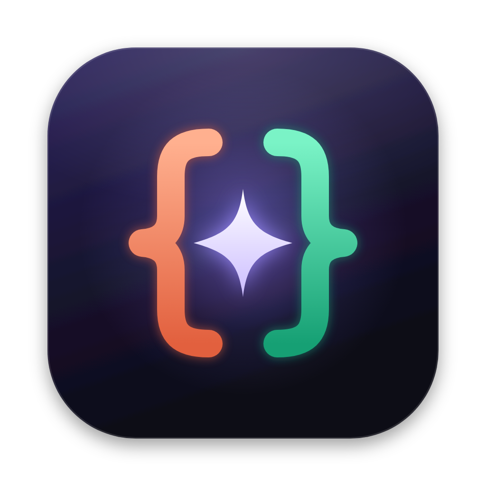

# Ambidex



[](https://github.com/DavLagoHern/Ambidex/actions/workflows/ci.yml) [](LICENSE) -lightgrey)

**Claude Code and Codex, working as one.** · [Español](README.es.md)

Ambidex is a macOS desktop app for building software with **Claude Code** and **OpenAI Codex**: one at a time, side by side, or together in a single chat that decides who should handle each message. It runs the **official CLIs** you already have installed and signed in, so it works with your existing Claude and ChatGPT plans. No API keys, and it never stores credentials.

> **Early project.** macOS on Apple Silicon only, and the interface is in Spanish for now (English is planned).

## Highlights

- **One chat, two agents.** Each message goes to the agent best suited to it, based on:
  - the kind of task (decided by a small local model, [Jev](https://github.com/feder-cr/jev), or by Claude Haiku, or by rules);
  - who is busy, how much of each plan you have used, and whether the message continues the last one.

  Every reply says who answered and why, and the agent that steps in gets the context of what was said with the other one.
- **Team mode.** For big tasks the agents plan, split the work and each work in their own git worktree. They review each other and run your tests. Nothing reaches your branch until you approve it.
- **Undo any agent turn.** Before and after every turn Ambidex snapshots your files as a git tree, using a temporary index. Your index, branches and history are never touched. Undo shows exactly which files would be restored or deleted, and skips the ones you changed afterwards.
- **Agents drive your browser tab.** A built-in web viewer is exposed to both agents through a local MCP server. They can:
  - open your `localhost`, read the page with numbered elements, click, type and press keys (real input events);
  - scroll, take screenshots and read console errors.

  You see a live banner while they do it, with a button to take control back. There is no tool to run arbitrary JavaScript.
- **See what the page sees.** Console errors and failed requests are counted next to the address bar; one click sends them to the chat. A camera button attaches a screenshot of the page. A ▶ button starts your `npm|pnpm|yarn|bun run dev` and opens its URL when the server prints it.
- **Images in the chat.** Paste, drag or pick images; both agents see them.
- **Pick up terminal sessions.** Ambidex lists the Claude Code and Codex conversations you started in a terminal or in VS Code for the same folder, and lets you continue them in the app. A Claude session that is still open elsewhere is continued in a fork, so the two never write to the same session.
- **Extensions at a glance.** Plugins, skills, subagents, commands, MCP servers, hooks and `CLAUDE.md`/`AGENTS.md` for each CLI, both yours and the project's. Secrets such as env values, headers and tokens are never shown.
- **Your layout.** Drag any panel by its header to swap it or dock it on a side. Save layouts, and pop the chat, terminal, editor or agent activity into their own window. A popped terminal stays the same shell.
- **Also included:**
  - a Monaco editor and terminals;
  - Git: multi-repo, staging, branches, conflicts, cherry-pick and revert, pull requests via `gh`;
  - an editable message queue and `/prompts`;
  - the state of every project, restored when you reopen it.

## Install from source

Requirements:
- macOS on Apple Silicon
- Node 22.15+ (24 recommended)
- Git
- [Claude Code](https://code.claude.com) and/or [Codex CLI](https://github.com/openai/codex), installed and signed in

```bash
git clone https://github.com/DavLagoHern/Ambidex.git
cd Ambidex
npm install            # dependencies + node-pty built for Electron
npm run dist           # builds and packages Ambidex.app (ad-hoc signed)
npm run install:app    # copies it to /Applications, adds a Desktop shortcut and opens it
```

The app is ad-hoc signed, which is fine for a build made on your own Mac; there are no notarized downloads yet. If a CLI is not signed in, **Ajustes → Agentes y cuentas** opens its official login in a real terminal inside the app. For development, run `npm run dev`.

## How it works

- **CLIs as child processes.** The official CLIs run as `claude -p --output-format stream-json` and `codex exec --json`.
  - The prompt goes through stdin, and arguments are always arrays, never a shell string.
  - Every event is stored in SQLite before it reaches the UI, so a crash or reload loses nothing.
  - Cancelling stops the whole process group.
- **Images.** Claude receives them as content blocks (`--input-format stream-json`) and Codex as `--image`. Only files from the app's own attachments folder can be sent.
- **Web tools.** A tiny MCP server (streamable HTTP, `127.0.0.1` only) is added to each turn with `--mcp-config` for Claude and `-c mcp_servers.*` for Codex. Your CLI configuration files are never modified. Each turn gets its own token in an environment variable, and the token expires when the turn ends.
- **Undo.** Snapshots are `git add -A` into a temporary copy of the index followed by `git write-tree`: no commits and no refs.
- Architecture notes (in Spanish): [docs/ARCHITECTURE.md](docs/ARCHITECTURE.md).

## Security

- The renderer is sandboxed. File paths are checked against the projects you opened, including through symlinks.
- Web pages have no preload and no Node access, use their own session, can only navigate `http(s)`, and get device permissions denied.
- The MCP server:
  - rejects requests that carry an `Origin` header (a web page) or a foreign `Host` (DNS rebinding);
  - rejects tokens from turns that have ended.
- Git commands from the UI use an allow-list and block `-c`, `--upload-pack`, `--exec` and similar options.
- Destructive actions ask for native confirmation.
- Nothing is merged into your branch or pushed without an explicit action from you.

## Subscriptions and terms

Ambidex launches the official CLIs with your own sign-in. What your plan covers is decided by each provider's terms, which changed several times in 2026.
- As of November 2026, Anthropic's help center says `claude -p` usage still draws from your subscription limits ([article](https://support.claude.com/en/articles/15036540-use-the-claude-agent-sdk-with-your-claude-plan)).
- For Codex, see [OpenAI's help center](https://help.openai.com/en/articles/11369540-using-codex-with-your-chatgpt-plan-usage-limits-and-troubleshooting).

Check both before relying on Ambidex for heavy use.

## Tests

```bash
npm run typecheck
npm test                                # 121 unit tests, no quota used
npm run build && npm run test:e2e       # end-to-end with the real CLIs (a few short messages)
E2E_SKIP_AGENTS=1 npm run test:e2e      # end-to-end without calling the agents
```

The CLI adapters are tested against output captured from Claude Code 2.1.316 and Codex 0.155.1.

## Known limitations

- **Platform and language:** macOS on Apple Silicon only, and the UI is in Spanish.
- **Permissions:** the CLIs run non-interactively, so anything that needs permission is denied, and the chat explains how to allow it. There is no live approval prompt.
- **Undo:** only works in git repositories.
- **Jev:** takes about 0.7 s per decision on an M-series Mac. If it doesn't answer in time, the rules decide.
- **CLI changes:** the output formats of the CLIs change often, and new versions may need adapter updates.

## Credits

[Jev](https://github.com/feder-cr/jev) (MIT) for local routing decisions. Built with Electron, React, Monaco, xterm.js, node-pty and Lucide.

## License

[MIT](LICENSE). Ambidex is an independent project and is not affiliated with or endorsed by Anthropic or OpenAI. Claude and Claude Code are trademarks of Anthropic; Codex and ChatGPT are trademarks of OpenAI.
